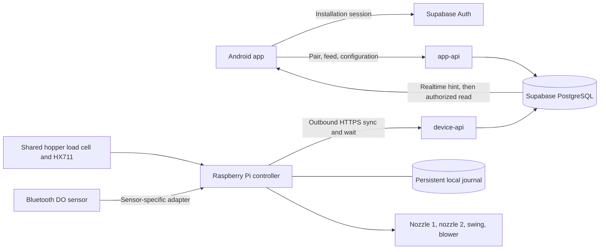

# AquaFeedPro: hardware developer handoff

Prepared **October 16, 2026 (Asia/Manila)**. Source baseline: `main`, commit **2d208eca9ad68485f0295eda33b8a5c5adfbeed2**. Wire contract **2.7.0**, `protocol_major: 2`.

## Start here

Your job is to build the Raspberry Pi controller that connects the physical feeder to the existing AquaFeedPro app through Supabase. The phone sends requests to the backend; the Pi downloads authorized work, executes it safely, and reports what actually happened. The phone never controls GPIO directly.

The owner confirmed the components in the supplied Revision B drawing: Raspberry Pi, two dispensing motors with separate DRV8871 drivers, a third DRV8871 for nozzle swing, a relay-controlled blower, and one HX711/load cell under the shared hopper. **DO comes from a Bluetooth sensor connected to the Pi.** Its model, Bluetooth protocol and calibration procedure are not yet known. Actual wiring may differ from the drawing: verify and record the installed pin map before using GPIO.

The owner and hardware developer will handle device setup together. Supabase already exists. Developer access is primarily for inspecting and troubleshooting that project; this handoff does not require recreating Supabase. The current hosted migrations/functions and a real-device record were not inspected during this handoff. The repository's provisioning tool is explicitly simulator-only, so confirm a real feeder has its own approved profile and credential before connecting it.

**The existing Python simulator is a behavior reference, not production firmware.** It generates readings, simulates successful motion, permits only two fixture device IDs, and uses simulator limits. Connecting a GPIO function to its `on_actuation` callback does not make it a safe hardware controller.

Read this packet in this order:

1. This guide: architecture, responsibilities, implementation and bring-up.
2. [Protocol reference](hardware-handoff/PROTOCOL-REFERENCE.md): exact fields, request/response examples and validation rules.
3. [Acceptance and troubleshooting](hardware-handoff/ACCEPTANCE.md): tests and evidence needed before enabling real feeding.
4. [Decisions and commissioning record](hardware-handoff/DECISIONS.md): fill in the physical values and shared setup information.
5. [Source scan and evidence](hardware-handoff/SOURCE-SCAN.md): reviewed areas, known gaps, source conflicts and verification limits.

When this packet says **implemented**, it means present in the reviewed source. **To implement** means firmware or integration work remains. **To verify** requires an observation on the actual hosted project, phone or feeder. A source check is not a bench result.

## 1. The complete connection



The Pi needs outbound HTTPS, DNS and a working network connection. It does not need a public IP, router port forwarding, an inbound phone connection or a permanent phone nearby. Applied schedules run locally when the internet is unavailable, provided the clock, inventory, actuators and safety state remain valid.

Three separate identities must stay separate:

| Identity | Used by | Meaning |
| --- | --- | --- |
| Anonymous Supabase installation session | Phone | Identifies this app installation; active device membership authorizes access |
| Permanent device UUID | Everyone may see it | Identifies the feeder; not a password |
| Revocable machine credential | Pi only | Authenticates exactly one feeder to `device-api` |

The publishable Supabase key is public project configuration. It does not replace either authenticated identity. A Supabase service-role/server secret belongs only in trusted backend/operator tooling, never on the Pi or in the Android app.

The Pi speaks **three endpoints** under `<SUPABASE_URL>/functions/v1`:

| Method and path | Purpose | What it must never do |
| --- | --- | --- |
| `POST /device-api/v2/sync` | Upload readings/events/config status; receive desired configuration and at most one manual command | Treat download or HTTP 200 as physical completion |
| `POST /device-api/v2/wait` | Hold up to 20 seconds for a work-change hint | Start a motor or set the clock from a wake response |
| `POST /device-api/v2/pairing-window` | Open a temporary pairing challenge after a locally authorized physical action | Return the reusable machine credential to the phone |

There is no Pi-to-database write path in this design. Do not make the Pi write `device_telemetry`, `feed_steps`, reservations or memberships directly. Do not use Realtime as the feeder's command queue.

## 2. What the app expects from the feeder

| User action or screen | Backend responsibility | Pi responsibility | What the user should see |
| --- | --- | --- | --- |
| Add feeder | Redeem one-use challenge; create membership | Present a fresh challenge after local authorization | Paired device, or an explicit pairing failure |
| Home monitoring | Store trusted current telemetry; compute freshness | Send actual readings and quality | DO in mg/L, one shared feed stock, unavailable/stale states when appropriate |
| Feed Nozzle 1 or Nozzle 2 | Admit command using profile, stock, access and reservation | Deduplicate, persist, execute selected nozzle once | Queued → accepted → running → actual final result |
| Feed Both | Authorize separate doses in order 1 then 2 | Hold one device lock through both legs and weighing | Independent nozzle results; partial or unknown when applicable |
| Save schedule | Store a complete desired snapshot | Validate, persist and atomically apply between operations | Pending until Pi acknowledges applied revision |
| Schedule runs offline | Store replayed evidence later | Execute applied schedule locally, once per date | History arrives when connectivity returns |
| Settings/limits | Version the configuration | Report application; keep old snapshot after rejection | Desired and applied state remain distinguishable |
| History | Reconcile durable events | Report truthful per-nozzle outcomes and measurements | Requested and measured amounts remain separate |
| Alerts/push | Generate shared alert facts and deliver phone push | Supply valid readings and final run events | Alert history and optional Android notification |
| Rename/location | Store shared metadata for all paired installations | No actuator action | Same feeder name/location on every authorized installation |
| Remove from app | Revoke that installation's membership | Continue already-applied schedules | Removal does not turn off the feeder |

An app notification is not a control or safety channel. The Pi does not send Expo/Firebase notifications itself. Low DO is currently monitoring/alert information; there is no approved biological feeding interlock to invent.

## 3. Hardware inventory and wiring boundary

The supplied drawing and XML agree on the following **reference** map. It is not a claim that the installed feeder uses these pins. Keep GPIO assignments in the physical controller's configuration, separate from the cloud protocol.

| Function | Drawing connection | BCM GPIO | Pi physical pin |
| --- | --- | ---: | ---: |
| Nozzle 1 drive | U2 IN1; U2 IN2 tied to GND | 18 | 12 |
| Nozzle 2 drive | U3 IN1; U3 IN2 tied to GND | 17 | 11 |
| Swing direction A | U4 IN1 | 22 | 15 |
| Swing direction B | U4 IN2 | 23 | 16 |
| Blower relay control | K1 IN | 24 | 18 |
| Load cell data | U5 HX711 DT | 5 | 29 |
| Load cell clock | U5 HX711 SCK | 6 | 31 |
| DO | Bluetooth link to Pi | None prescribed | None prescribed |

Physical pin 33 / BCM13 is marked damaged in the drawing and must not be reused on that board. The old `fishFeeder/src/test/hardwaretest.py` still uses BCM13 and an MG996R on BCM19. Those tests do not match this design. The old `Motor` class requires two PWM GPIOs and supports reversing; it cannot be used unchanged for dispensing drivers whose IN2 is physically grounded. The swing motor is a DC motor in this design; the legacy servo sweep is not its controller.

The drawing shows an HX711/load-cell connection and a relay/blower connection but leaves supply selection, protection, independent cutoff and position feedback incomplete. Record the actual board variants, motor/blower voltages and startup/stall currents, driver current limits, fuse/wire ratings, relay input polarity and contact rating, grounding and sensor signal levels. Keep motor return currents out of the scale's signal path. Verify safe outputs during power-on before the process starts.

Pi GPIO uses 3.3 V signaling; check the purchased boards' interfaces rather than assuming their supply labels imply compatible outputs. See the official [Raspberry Pi GPIO guidance](https://pip-assets.raspberrypi.com/categories/685-app-notes-guides-whitepapers/documents/RP-006553-WP/A-history-of-GPIO-usage-on-Raspberry-Pi-devices-and-current-best-practices).

For DRV8871, both inputs low select coast/high impedance; both high select brake. With IN2 grounded, the dispensing control cannot select reverse or the both-high brake state. Therefore “set PWM to zero” is not evidence that the shaft has stopped. Measure stopping/coasting behavior and use a suitable independent stop/cutoff design. See [TI's DRV8871 datasheet](https://www.ti.com/lit/ds/symlink/drv8871.pdf).

At nominal 60 RPM, one second is only the nominal period of a revolution. It is not a measured revolution or a calibrated mass. If one output-shaft turn is required, the developer must establish how the mechanism detects it. The swing needs an identified home position, intended endpoints, bounded motion and a way to detect failure to reach them. Do not claim a precise 45-degree movement from a time delay alone.

The exact blower/swing sequence is a mechanical commissioning decision: when to start airflow, whether swing runs during dispensing, when airflow stops, and which parts must stop before weighing. No separate blower or swing command exists in the app protocol. Their operation is internal to a nozzle feed cycle and included in the device-wide lock and safety limits. If independent remote blower/swing controls are required, that is a separate app/backend/contract change.

## 4. DO over Bluetooth: deliberately device-independent

The required result is straightforward: the Pi obtains a real dissolved-oxygen reading from the Bluetooth instrument and sends it as `do_mg_l` with a quality value. The mobile app does not need to know whether that instrument uses Bluetooth Low Energy, serial-style Bluetooth or a vendor library.

Implement one small adapter around the actual instrument. Its internal interface should return:

| Adapter result | Meaning |
| --- | --- |
| Dissolved oxygen in mg/L, or no usable value | A finite, nonnegative concentration after verified unit conversion |
| Quality | `valid`, `unavailable`, `uncalibrated`, or `error` |
| Last successful acquisition time on the Pi's monotonic clock | Determines whether the reading is genuinely recent |
| Instrument identity and connection state | Prevents accepting data from the wrong nearby sensor |
| Diagnostic/calibration information, when available | Local troubleshooting and acceptance evidence; not extra keys in the current wire DTO |

Developer discovery steps:

1. Record the exact instrument model and obtain its communication instructions from the supplier.
2. Determine whether readings are notifications, periodic reads, a serial stream or a vendor SDK. Do not guess a BLE service UUID, characteristic, packet layout or baud setting.
3. Determine how the Pi selects and authenticates the intended instrument. Store any Bluetooth bonding material securely.
4. Determine the reported unit. Percent saturation, raw counts and mg/L are different. If conversion needs temperature, pressure or salinity, obtain those inputs and the manufacturer's conversion method before reporting mg/L.
5. Define a verified acquisition interval, read timeout, reconnect policy and maximum age. A Bluetooth connection being open does not prove a new measurement arrived.
6. Check malformed packets, wrong units, non-finite values, disconnected sensor, calibration-required states, and a sensor that stops changing its sequence/time while the connection stays open.
7. Reconnect with bounded backoff in a task that cannot delay the motor watchdog or local schedule processing.

Map the result to the existing telemetry contract:

| Instrument condition | `do_quality` | `do_mg_l` |
| --- | --- | --- |
| Fresh, calibrated, successfully decoded mg/L reading | `valid` | Actual finite value |
| No instrument, disconnected, or no fresh reading available | `unavailable` | `null` |
| Calibration absent/expired according to the instrument's procedure | `uncalibrated` | `null` |
| Explicit device fault, malformed data or invalid conversion | `error` | `null` |

Never send zero to represent Bluetooth loss. Never replace a missing reading with a constant “normal” value. Repeatedly transmitting an old cached value with a new `measured_at` would falsely make it fresh; do not do it.

The current wire sample has one `measured_at` for the combined sensor sample, not separate timestamps for DO and the load cell. Keep individual acquisition ages locally; include DO as valid in a new combined sample only when its freshness meets the agreed acquisition policy. Otherwise send DO unavailable while still reporting valid stock. If accurate independent sensor timestamps are required, coordinate a contract change instead of adding unrecognized fields.

`calibration_revision` in the current telemetry validation is coupled to feed/load-cell validity. It is not a separate DO calibration report. Retain the DO calibration certificate, method and revision locally in commissioning evidence. Report DO quality honestly. A Bluetooth outage alone does not make the whole feeder offline and does not automatically prohibit feeding unless the owner later approves such an interlock.

## 5. One-time setup with the owner

Complete this checklist together before the real agent's first connection. This is confirmation/configuration of the existing system, not a backend rebuild.

| Item | What to obtain | Who owns it |
| --- | --- | --- |
| Deployment baseline | Approved Supabase project URL; deployed `device-api` and `app-api` revision; migrations compatible with 2.7.0 | Owner/backend maintainer |
| Physical identity | A new UUID for this physical feeder; model/unit record; `is_simulated=false` | Owner with hardware developer |
| Machine credential | Independently generated revocable secret for that UUID; server stores its verifier | Owner/backend maintainer; securely installed on Pi |
| Public API configuration | Project URL and publishable key | Owner |
| Approved capability profile | Exact profile/revision matching the actual mechanism; no simulator limits copied | Joint approval from measured evidence |
| Local profile copy | Same approved bounds available to firmware before it admits work | Hardware developer |
| Pairing presentation | Agreed physical trigger and temporary display/maintenance method | Joint decision; hardware implementation |
| Operating timezone | Typically `Asia/Manila` for this installation; confirm and save through configuration | Owner |
| Recovery authority | Who may inspect and clear unknown operation state or recover a lost phone | Owner and hardware developer |

The repository's `art38_provision_simulated_device` RPC and `provision-d2-devices.mjs` only provision controlled simulated devices. They are not a real-device onboarding command. If the physical record/credential already exists, verify it and preserve it. If not, the backend maintainer must supply a reviewed provisioning procedure for the physical device. Do not flip a simulator row to real, reuse its UUID, copy its secret or give the Pi the project server key to work around this gap.

The device sync request advertises `capabilities_revision`, not the whole capability profile, and the response does not deliver the full hardware limits. Supply the approved local profile during installation and update it through a controlled operator procedure. Matching only the revision integer without matching the actual bounds is insufficient.

The required profile fields are listed in the protocol reference. In particular, decide each nozzle's enabled state, dose modes, calibrated minimum/maximum/step or fixed-portion IDs, measured-dispense support, maximum actuation time and cooldown; the shared hopper capacity; maximum settling time; clock uncertainty; scheduling support/count/grace; and whether scheduled Both is proven. Null means unknown, not zero. Keep unproven controls disabled.

The simulator now uses capability revision 5, 20,000 g capacity, synthetic 5–20,000 g dose bounds, 15,000 ms actuation bounds and 1,000 ms clock/settling bounds. **None is a physical recommendation.** Hopper capacity and permitted dose are separate values; a 20 kg container does not prove one 20 kg feed is safe or achievable within the watchdog limit.

## 6. Pairing, printed QR and access recovery

A permanent printed QR contains only identity:

```json
{"protocol_major":2,"purpose":"device_identity","device_id":"11111111-1111-4111-8111-111111111111"}
```

That UUID is an example, not an allocated real feeder. Scanning this public label identifies/selects the device; it does not grant access. The current app distinguishes the public QR from a temporary pairing QR. Do not print a pairing secret or machine credential on a permanent sticker.

The temporary pairing process is:

1. A person at the device performs the agreed physical/authorized maintenance action.
2. The Pi calls `POST /device-api/v2/pairing-window` with its machine bearer credential and a new request UUID.
3. The server returns `request_id`, `challenge_id`, `pairing_secret`, and `expires_at`.
4. The Pi presents a temporary QR or the exact fields needed by the app's manual pairing screen. The app's QR parser expects exactly `protocol_major`, `device_id`, `challenge_id`, `pairing_secret`; do not insert `purpose` or `expires_at` into this QR.
5. The phone redeems it with its own installation JWT through `/app-api/v2/pair`.
6. The backend atomically grants membership and consumes the challenge. A later installation needs a new authorized pairing window.

Current backend values: a secret from 32 random bytes, a five-minute challenge, up to five failed challenge attempts, and a pairing-window rate limit of five per 300-second window per device. The app pairing endpoint is separately limited to ten per 600-second window per installation. Creating a new window does not itself revoke every earlier unexpired challenge in the reviewed implementation; minimize concurrent presentation and do not describe a refresh as revocation. Read `expires_at`; do not create your own longer validity period. A repeated pairing-window request ID is rejected, because the backend cannot return the original plaintext secret. A lost response requires a deliberate fresh window/request, not automatic recreation of pairing windows in the normal sync loop.

The API cannot observe a button press. Firmware must enforce the physical action before calling this route. The device-only response is intentionally secret-bearing: do not put it in diagnostic logs or reports. Display the temporary challenge only through the approved local method and remove it on expiry.

Reinstalling the app creates a new installation identity. Pairing a new phone does not automatically revoke a lost phone. The owner must revoke the lost membership, or all relevant memberships if it cannot be identified, using a reviewed operator recovery procedure. Credential rotation is separate from membership revocation. Removing a feeder in the app does not erase local schedules; pause schedules and verify application if stopping future scheduled feeding is intended.

## 7. Firmware structure to implement

Use the existing durable runtime behavior as a reference and keep the physical adapter small. These are responsibilities, not a requirement to create a framework or one file per row.

| Responsibility | Required behavior |
| --- | --- |
| Safe startup/shutdown | Outputs disabled before loading schedules or contacting the network; stop on termination; independent cutoff remains effective on a crash |
| Hardware adapter | Read scale and Bluetooth DO; control selected nozzle, swing and blower; return evidence, never inferred success |
| Execution manager | One reservation for the whole device; validate bounds and inventory; persist before movement; perform sequential steps |
| Durable journal | Store identities, intents, events, sample sequences, configuration, occurrences, lockouts and acknowledgments across restart |
| Local scheduler | Execute only the applied snapshot using trusted time; stable occurrence keys and no replay |
| Sync worker | One outstanding sync; validate response; acknowledge exact IDs; stage configuration and commands |
| Wait worker | Separate connection; wake sync only; timer fallback if unavailable |
| Maintenance | Physical pairing, diagnostics, inspection/lockout resolution, controlled calibration and provisioning |

The network worker must not block hardware stopping or time-critical scheduling. The simulator's execution callback and sleeps are synchronous and its measurements are synthesized; do not copy that execution model directly into the hardware control loop.

Conceptual startup order:

```text
disable actuator outputs and establish independent cutoff
acquire single-process ownership of this feeder
open and verify durable journal, device identity and approved local profile
load calibration without overwriting or automatically taring a loaded hopper
reconcile unfinished operations conservatively; preserve lockouts and IDs
start sensor acquisition and clock quality tracking
start local scheduler and sync/wait workers
allow a feed only when all admission and physical safety checks pass
```

Local storage must survive service restart, OS reboot and loss of internet. The simulator uses SQLite WAL, `synchronous=FULL`, foreign keys and `BEGIN IMMEDIATE`; these are useful patterns. Choose a persistent data directory, one writer/agent per device, restrictive permissions and a backup method that preserves a consistent database and its WAL. A read-only/full/corrupt disk must stop new feed admission before movement. Do not delete the journal to “fix” an unknown run; that destroys duplicate-prevention evidence.

Persist at least:

- Device UUID, immutable local profile revision/hash, calibration revision and firmware version.
- Manual `command_id`, `sequence_id`, original `idempotency_key`, immutable ordered targets and deadline.
- Per-step state, physical-start intent, actual start/stop/settling evidence and requested versus measured dose.
- Monotonic `event_sequence` for each sequence and immutable unacknowledged events.
- Applied configuration and last configuration attempt; schedule occurrence ledger and retired schedule identities as needed.
- Per-device `live_sequence` that survives reboot, a new boot UUID, pending telemetry and lost-sample intervals.
- Unresolved safety lockouts and audited maintenance resolutions.

## 8. HTTPS sync and wake loop

Use UTF-8 JSON, TLS certificate verification, bounded timeouts, and the headers shown in the protocol reference. Never log Authorization values. Generate a new request UUID for each exchange and verify the response correlation; event/sample/command identities remain stable during retries.

Maintain separate persistent HTTPS connections for sync and wait. Only one sync may be in flight for a device. `wait` is allowed concurrently. Start with `seen_work_token: null`, retain the returned opaque token, and call sync promptly when `changed: true`. A wait round-trip can intentionally take 20 seconds, so it is not a clock sample.

Continue timed sync regardless of whether wait works. Honor `next_sync_after_ms` within the controller's bounded scheduling policy, and request an upload within 250 ms of a new durable event when connectivity and retry policy permit. The reference client clamps ordinary sync delay to 250–10,000 ms, uses 15-second sync/30-second wait transport timeouts and a three-second failure retry; those are reference transport choices, not certified hardware timing. Use bounded retry/backoff without a tight failure loop. On wait HTTP 404, fall back to timed sync; do not treat it as permission to bypass authentication.

Before accepting any returned work, validate the full response shape, `protocol_major`, request ID, command identity, device UUID, profile revision, dose bounds, state, clock and deadline. Unknown/malformed work must not energize outputs. A server response cannot override local lockout, stop evidence or inventory checks.

The current sync implementation writes telemetry, configuration reports, scheduled events and manual events through separate RPC calls. Some earlier writes may persist when a later call fails. On timeout or any failed exchange, retain pending records and retry their **same immutable identities and content**. Only remove records from the outbox after their explicit acknowledgment in a validated successful response. Acknowledgment means stored evidence, not new permission to feed.

A batch contains at most 100 events and 100 telemetry samples total. A live sample leaves room for 99 backlog samples; with `latest_sample: null`, 100 historical samples are allowed. The entire JSON request must fit 262,144 bytes. Batch by both byte size and record count. Keep events ordered within each sequence, and never send duplicate sample identities in the same request.

## 9. Manual feeding, step by step

The app asks for Nozzle 1, Nozzle 2 or Both and a separate dose for each. The backend checks installation access, capability revision, enabled nozzles, dose bounds, current stock, contact freshness, existing reservation and lockout before creating a command. Its `start_before` is currently one minute after admission. That is a start deadline, not an allowed motor run duration.

The current manual admission policy **requires fresh valid measured shared stock**, even for fixed portions. For gram targets, stock must cover the sum. Fixed portions have no implied gram equivalent: backend checks known gram subtotal and requires positive remaining stock beyond it, but cannot prove the portion's mass. Hardware still needs its own conservative portion/inventory policy. If no working stock sensor is available, manual feeding is blocked under the current app/backend policy; do not send invented inventory to unlock it.

On receipt of a new command:

1. Check `command_type=feed`, all identities, this device UUID, exact capability revision, ordered targets, supported modes and bounds.
2. Look up the original command/sequence/idempotency identity in persistent storage. Identical delivery is a replay: return existing evidence and do not move again. Same identity with changed content is a conflict.
3. Check trusted time and the first step's deadline. If the start was definitely never attempted and the deadline passed, report a non-start outcome. If a start may have happened, preserve `unknown`.
4. Acquire the device-wide reservation shared with the scheduler. Check safety lockout, fresh settled baseline, stock, mechanism readiness and cooldown. No unrelated request may queue secretly behind this command.
5. Commit acceptance and step records before motion. Immediately before enabling outputs, recheck deadline, ownership, clock, profile, stock and safety. Commit physical-start intent so a crash cannot erase the possibility of movement.
6. Operate only the selected nozzle using its approved mechanical cycle, with the required blower/swing behavior. Enforce maximum runtime using a monotonic clock and an independent watchdog/cutoff.
7. Stop, verify the stop, wait for a valid settled shared-hopper measurement, and persist the outcome and evidence. Keep the reservation throughout.
8. For Both, proceed to nozzle 2 only after the prior leg's stop and valid baseline. Its start deadline derives from the settled prior step/baseline plus the approved `scheduler_wake_grace_ms`; do not reuse nozzle 1's expired original deadline.
9. Recheck nozzle 2's stock and safety immediately before starting it. Record separate results; release the reservation only after the final safe stop and settling, or preserve lockout if unresolved.
10. Upload events promptly, and keep retrying delivery of stored evidence without repeating physical action.

For a single Nozzle 2 command, `nozzle_number=2` but `step_index=1`. Step index describes order in this sequence, not the hardware outlet number. Event numbering belongs to the entire sequence, not a new counter per nozzle.

### Outcomes and what they mean

| State | Meaning |
| --- | --- |
| `queued` | Backend recorded the request; no physical completion implied |
| `accepted` | Controller durably accepted it; movement is not proven |
| `running` | Physical execution was entered; crash recovery must consider movement possible |
| `completed` | Cycle completed according to the approved physical procedure; amount may still be unavailable |
| `failed` | Known unsuccessful cycle; a valid measured partial amount may exist |
| `rejected` | Work refused; no actuation for that rejected step |
| `expired` | Deadline prevented a confirmed non-start; never use to hide a possible start |
| `unknown` | Physical outcome cannot be established; no automatic retry |
| `not_started` | A later/accepted leg did not run; include a reason |
| `skipped` | Scheduled occurrence intentionally did not execute; include a reason |
| `partial` | Aggregate sequence result with exactly one completed nozzle; not a per-step RunEvent outcome |

If nozzle 1 completes and nozzle 2 fails, retain both results. An unknown leg takes priority as unresolved uncertainty. Do not convert a completed-but-unmeasured cycle into measured success, or a failed cycle with a valid measured amount into zero.

### Conditional continuation after a failed nozzle 1

Contract 2.5+ allows the already-authorized nozzle 2 to run after a **known failed** nozzle 1 only with explicit `continuation_evidence`: `safe_stop=true`, `device_fault=false`, and a trusted `baseline_ready_at`. The failed first event must have valid weighing and trusted time, be step 1/nozzle 1 in a two-target sequence, fit the actuation-plus-settling time window, and pass the server's health/profile/lockout checks. The baseline must be at or after the first start and no later than the failed-event time.

**Initial real firmware should omit this field and stop remaining legs until the hardware acceptance tests prove those signals.** Sending the flags because the code called `stop()` is not evidence. A device-wide fault, unknown stop, invalid scale, untrusted clock or lockout always prevents continuation. Nozzle 1 is never retried by this rule. Nozzle 1 failed plus nozzle 2 completed yields `partial`.

## 10. Applied configuration and offline schedules

The backend returns a full `desired_configuration`, or `null`. It contains revision, based-on revision, timezone, monitoring limits, low-feed threshold and schedules. Each current schedule uses ordered `targets`; the old scalar `nozzle_number`/`dose` schedule format is obsolete. `protocol_major:2` alone is not enough to establish schedule parser compatibility: this packet targets contract 2.7.0.

Validate the whole snapshot before changing anything. Validate UUIDs, exact accepted fields, revision chain, timezone, `HH:MM` local time, weekday integers 1–7 (Monday=1), unique days/schedule IDs, supported dose/profile bounds, schedule count, and overlapping use of one nozzle. Both needs `scheduled_both=true`. Do not partially apply a snapshot by silently dropping an unsupported target or schedule.

Stage valid changes while a feed/reservation is active; switch atomically between operations. Persist the new applied snapshot before reporting `last_attempt_status: applied`. On rejection, preserve the prior applied snapshot and report the attempted revision/error. The simulator tracks the expected `based_on_revision` against its last attempt when present, otherwise its applied revision; rejected attempts therefore matter to revision reconciliation. Do not implement a simplistic “must equal last applied” rule that loses rejected revision history.

Recurring schedules are executed **on the Pi**, not by phone timers or cloud cron. Persist one occurrence identity `(device_id, schedule_id, occurrence_local_date)`. A dose/nozzle/configuration edit must not cause another occurrence that day. A Both schedule has one schedule ID and one daily occurrence, with two ordered steps. Two separate schedules due at the same instant on different nozzles share one ordered group. Same-time schedules that overlap a nozzle are invalid, including Both plus a single-nozzle schedule.

At due time, atomically claim the occurrence(s) and reservation, check clock/stock/safety, then execute using the same physical path as manual feeding. Generate and persist the sequence identity locally, and send scheduled events with the schedule ID, applied configuration revision and local date. `ScheduledSequenceAdmission` in the schema documents admission semantics; it is not an extra HTTP endpoint or an instruction to ask the cloud before every scheduled run.

On a manual/scheduled collision, reject/skip explicitly. Do not add a general queue. On reboot or a forward clock jump, mark missed occurrences skipped; never perform catch-up feeding. Handle DST nonexistent local times as skipped and repeated local times once. Test this even if the installation initially uses Asia/Manila. Timezone changes must be explicit configuration changes, never inferred from the phone's timezone.

## 11. Time and uncertainty

Use UTC timestamps ending in `Z` for event/sample times and IANA timezone names for recurring local schedules. `time_quality` is one of `synced`, `rtc`, `uncertain`, `invalid`. Invalid time requires a null timestamp and null clock uncertainty. Other time qualities require an actual UTC timestamp and nonnegative uncertainty; “uncertain” is not equivalent to trusted.

The Pi's actual RTC/holdover arrangement is not yet confirmed. Do not advertise `rtc` just because the simulator does. Establish the real time source, synchronization, drift bound, behavior without internet and power-loss recovery. Suspend deadline-sensitive starts and schedules if uncertainty exceeds the approved profile. Measure durations, runtime limits and cooldowns with a monotonic clock so wall-clock corrections cannot extend actuation.

Use short sync exchanges for bounded server-time observations if that is part of the chosen design; include network delay and holdover drift in uncertainty. The reference manual-command clock observation expires after 60 seconds and rejects exchanges slower than 15 seconds. Its offline scheduler separately uses a simulated wall-clock profile. Neither implementation proves that a Pi can keep safe time offline. Wait responses never establish clock trust.

## 12. Shared weighing, dose measurement and inventory

There is one hopper and one scale. Never maintain independent fictitious stock per nozzle. A nozzle's requested amount, optional estimate, measured amount and the hopper's remaining amount are distinct facts.

Calibrate the installed mechanical assembly with traceable known weights and record tare, counts-per-gram, load-cell/module identity, capacity, resolution, repeatability, drift and calibration revision. Preserve existing calibration until reviewed; do not automatically tare a hopper containing feed at every startup. The old `loadcell.py` stores `zero_raw` and `counts_per_gram` but has no wire-quality adapter, settled-baseline detector or complete physical acceptance evidence. It also initializes GPIO/HX711 at import time; importing it is not a read-only diagnostic.

For each nozzle, a candidate measurement is `settled_before_g - settled_after_g`. It becomes `measured_dispensed_g` only if both measurements and attribution are valid under the commissioned method. Validate vibration, blower effects, swing forces, feed bridging, spill/leak paths, refilling during a run, hopper contact with surrounding structures, load-cell overload, negative deltas and implausible jumps. A scale drop does not automatically prove all material reached the intended outlet; verify it against independently weighed catches.

Define “settled” using measured stability over a time window, valid calibration and bounded acquisition age. A fixed 50 ms sleep copied from the simulator is not a settling detector. Include a maximum settling deadline; if it fails, leave the amount null with the appropriate quality and stop remaining legs.

For valid feed telemetry, provide **all three**: `feed_remaining_g`, `feed_percent`, and positive `calibration_revision`. For unavailable/uncalibrated/error feed readings, all three are null. If an approved capacity exists, remaining stock cannot exceed it, and percent must agree with `round(remaining_g * 100 / capacity_g, 2)` within the backend's 0.05 percentage-point tolerance. Do not independently invent percent or clamp an overload into a healthy full reading.

Before admission and before each physical step, use fresh measured available stock. After refill, reacquire a settled measurement. Never reset stock to full on reboot or subtract the requested dose as if it were measured. After an unknown run, invalidate stock until freshly observed; a new stock reading alone does not resolve uncertainty about the old run or clear its lockout.

The wire cannot describe every internal scale diagnostic. Keep detailed local evidence and map the outward result to the existing quality/value fields; propose versioned additions if needed rather than adding keys rejected by the API.

## 13. Recovery, maintenance and fail-safe behavior

Reboot recovery must first disable outputs, then inspect the journal. The important distinction is whether motion could have occurred:

| Persisted evidence | Recovery behavior |
| --- | --- |
| Accepted, with proof the start path was never entered | Mark remaining work not started/expired or skipped as appropriate; do not resume it |
| Running or possible physical start without reliable terminal evidence | Mark affected step unknown, retain lockout, stop later legs |
| Previous step durably completed and settled, next leg not entered | Preserve completed result and mark later leg not started; do not resume Both |
| Completed terminal evidence, upload unacknowledged | Replay the same events; no motor activity |
| Corrupt/missing journal or identity mismatch | Disable actuation and require maintenance; do not create a new empty ledger and continue |

A crash between committing “running” intent and physical movement may conservatively yield unknown even if no feed actually moved. That is preferable to repeating a possibly executed command. The controller cannot atomically commit a database row and move a motor; the physical uncertainty must be represented honestly.

For manual unknown outcomes, the current API supports a device-authored `maintenance_acknowledged` event after actual inspection. It retains `outcome_status: unknown`, null measured amount, and records `maintenance_resolution` plus `lockout_cleared:true`. Clearing permission for future operation does not rewrite the past as completed. Firmware must protect the maintenance operation from unauthenticated remote use and never emit it automatically on restart.

**Scheduled unknown recovery is an open integration gap:** `validRunEvent` currently rejects `maintenance_acknowledged` when `source=scheduled`, while the simulator retains a scheduled lockout. Agree and implement a reviewed backend/firmware recovery path before unattended physical scheduling is enabled. Do not bypass it by editing database lockout fields or deleting the local occurrence journal.

There is also no remote emergency-stop/cancel command in the current command contract, which only defines `feed`. The app is not an emergency stop. Provide the local physical stop/cutoff mechanism and its tested behavior. A network outage, frozen Python process or Linux reboot must not leave an actuator energized indefinitely.

## 14. Installation, service and operator diagnostics

The exact Pi OS, Python version, GPIO library and Bluetooth library must be selected after checking the target Pi and instrument. The repository's host checks use Python 3.14 and Node 24; this is not proof that every Pi GPIO dependency supports that runtime. Record an installed dependency lock and test it on the actual Pi.

Recommended deployment layout, to finalize with the developer:

| Location/responsibility | Contents |
| --- | --- |
| Application release directory | Versioned firmware and locked runtime; no mutable journal |
| Private configuration directory | Device UUID, approved profile, URL/public key, separate restricted credential file |
| Persistent data directory | SQLite journal, configuration snapshots, calibration and audit records |
| Bounded diagnostic log | Boot ID, firmware/profile revision, event/command IDs, state transitions and redacted errors |

Use a supervised service with safe startup, single-instance ownership, orderly stop and bounded restart behavior. An automatic process restart must run recovery, not reissue the previous feed. Keep local schedule/safety processing alive without network access. Grant only the device permissions the actual GPIO/Bluetooth implementation needs; do not run everything as root by default. There is no ready-to-install physical-agent entrypoint or service unit in the reviewed repository, so the developer must deliver these with the firmware.

Diagnostics should answer: which feeder/profile/firmware is running; whether time is trusted; last successful sync and last new sensor acquisition; current applied/desired configuration; active sequence/nozzle; stock quality; watchdog state; pending event/sample counts; and why feeding is disabled. Keep machine credentials, pairing secrets, phone sessions and Supabase server keys out of logs and screenshots.

Upgrade procedure: stop admission, finish or safely stop any active work, preserve journal/calibration/credentials, install the reviewed release, verify storage compatibility, restart through recovery, confirm telemetry and configuration, then re-enable only approved controls. A rollback must retain the newer journal safely; if the old firmware cannot read it, stay disabled rather than discarding data.

## 15. Delivery sequence and exit criteria

| Stage | Developer deliverable | Exit evidence |
| --- | --- | --- |
| A. Inspect and agree | Actual wiring/component list, Bluetooth discovery notes, owner-provided connection/profile record | Decisions sheet filled for connectivity; no guessed secrets/limits |
| B. Connect without movement | Physical agent authenticates; telemetry and quality handling; protected pairing presentation | Owner sees real-device identity and honest readings on Android; outputs remain disabled |
| C. Durable controller with fake actuator | Journal, deduplication, scheduler, outbox, restart recovery and profile validation | Offline test matrix passes without GPIO |
| D. Instrument and calibrate | Scale/DO validation, motor/stop/feedback characterization, independent cutoff | Recorded bench evidence and approved physical profile |
| E. Single-nozzle bench | Selected nozzle feeds once through the app; catch weight and reported outcome compared | Each nozzle passes approved accuracy/stop criteria separately |
| F. Sequential Both | Shared lock, settled baseline, per-nozzle results, collision handling | No overlap/interleaving; no invented measurements; fault cases pass |
| G. Offline scheduling | Applied snapshots, trusted offline clock, occurrence ledger and recovery | Network/reboot/time-change tests pass; scheduled-unknown recovery resolved |
| H. Final handoff | Firmware source/release, install/service instructions, profile, calibration, diagnostics, recovery and evidence | Acceptance checklist signed by owner and developer |

Conditional failure continuation is a later optional gate within F/G, enabled only after actual stop, health and settled-baseline evidence is proven. Basic safe sequential feeding can be delivered while continuation remains disabled.

Do not enable all features at once to get an “online” screen. A real device can first connect with unavailable readings or disabled controls. Enable each capability only after the corresponding evidence exists.

## 16. What to give back to the owner

Deliver the exact firmware commit/release and dependency lock; a reproducible installation/service guide; the as-built wiring/pin map and module identities; approved profile and calibration records; the Bluetooth integration notes and disconnect behavior; safe-stop/watchdog evidence; test results with device/boot/sequence IDs; and the operator procedures for refill, calibration, pairing, credential rotation and unknown-run recovery.

The owner needs a demonstration on the physical Android app showing pairing, real telemetry, each single nozzle, Both, schedule application, a schedule with the phone closed/internet disconnected, reconnect history, and controlled failure/unknown states. Keep measured timing and weighed results separate from simulator results. Use the acceptance document to record observed passes, failures and unrun cases.

The questions that remain are engineering inputs, not reasons to rebuild the app: actual pin map; Bluetooth instrument protocol; clock/RTC; calibration and dose limits; swing/blower timing and feedback; independent cutoff; physical pairing presentation; the real provisioning record; and scheduled-unknown recovery. Record each in [DECISIONS.md](hardware-handoff/DECISIONS.md) with an owner and evidence.
