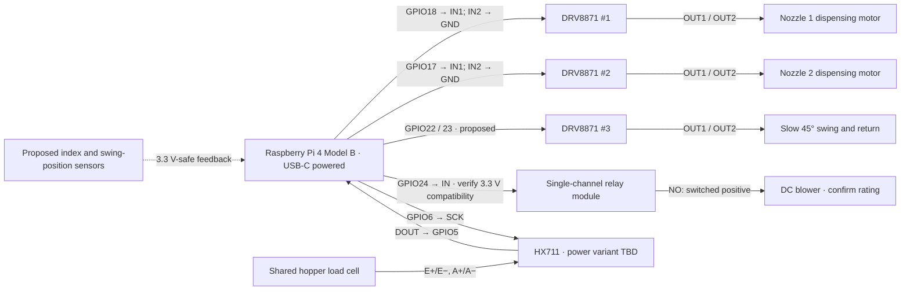

# AquaFeedPro hardware wiring — draft

**Revision B, October 13, 2026:** the accompanying KiCad drawing now omits both power-supply blocks and uses a single-channel relay module (VCC/IN/GND, COM/NO/NC), following the user's reference. Power-source and protection recommendations below remain engineering notes outside the drawing. The Pi 4 Model B is powered through USB-C; the reference image does not identify the relay's exact model or ratings.

Prepared October 12, 2026 (Asia/Manila). **Presentation design proposal.** The accompanying `kicad/AquaFeedPro-Wiring.kicad_sch` passes KiCad ERC and exported-netlist checks. Exact module variants, supply ratings, protection values and position sensors remain unconfirmed; ERC does not establish readiness to energize.

## Confirmed intent

- Raspberry Pi 4 Model B.
- Three DRV8871 modules: two for separate 60 RPM dispensing motors, one for a motor that swings the nozzle slowly through 45 degrees and returns.
- One relay module to switch the blower.
- One HX711 connected to the shared hopper load cell.
- Each dispensing motor uses one GPIO: IN1 receives control and IN2 connects to GND. Physical header pin 33 (BCM13) is damaged and is not used.
- User clarified the third motor as a slow swing, not two full shaft turns. The exact endpoints (0–45 degrees versus ±45 degrees) still need confirmation; this draft uses 0–45 degrees.

## Research: free schematic MCP options

KiCad is open-source electronic design software. These third-party MCP projects publish MIT licenses; the local software does not require a schematic subscription. AI/client usage is separate. ProductOfAmerica's server was subsequently installed and used to create and export the accompanying schematic through MCP.

| Option | Documented capability | Assessment for this task |
| --- | --- | --- |
| [ProductOfAmerica/mcp-server-kicad](https://github.com/ProductOfAmerica/mcp-server-kicad) | Schematic read/write, net tracing, electrical rule checking, PDF/SVG exports; Python 3.10+; KiCad required for checks/exports and stock libraries | Best first candidate for a schematic-focused trial. Maintainer documents Windows CI. |
| [mixelpixx/KiCAD-MCP-Server](https://github.com/mixelpixx/KiCAD-MCP-Server) | Schematic editing, custom symbols, ERC/DRC and exports; Windows support; Node.js and Python | Alternative with a larger setup. Its MIT server is separate from its newer Konnect offering. |

[KiCad project](https://www.kicad.org/about/kicad/). Installed MCP server: `mcp-server-kicad 0.20.1` at `D:\Tools\kicad-mcp\venv`, registered in the existing Codex configuration. Existing KiCad 9.0.4 was found at `D:\New folder`. The server was accessed through the MCP Python client over stdio for schematic creation, custom symbols, wiring, ERC and PDF/SVG exports.

For this prototype, model the actual purchased modules and terminal labels, not only bare IC pins. Final deliverables should be an editable `.kicad_sch`, checked net connections/ERC report, PDF/SVG wiring sheet, pin table and component/protection list. ERC does not prove module ratings, mechanical stopping or physical wiring safety.

## Evidence checked

- Local `fishFeeder/src/loadcell.py:10–11`: HX711 DOUT=BCM5, SCK=BCM6. Import initializes hardware, so files were read as text only.
- Local `fishFeeder/src/test/hardwaretest.py:14–18`: motor IN1=BCM18, IN2=BCM13; legacy servo=BCM19. The motor test runs for two seconds; that is not a measured rotation count.
- Local `fishFeeder/src/motor.py`: reusable single-motor PWM driver; no angle/revolution feedback. `stop()` sets both inputs low, which means coast/sleep on DRV8871, not a positive position hold.
- Local `fishFeeder/src/main.py`: load-cell monitor, not an integrated three-motor/relay controller. No relay, index-sensor or swing-limit controller was found in the six Python source files.
- [Notion hardware handoff](https://app.notion.com/p/3ec224a56ef38117967fccea6611e02f), read live: two nozzles, one suspended shared hopper/load cell, nozzle 1 then nozzle 2, settled measurement between them, no automatic repeat after an uncertain outcome.
- [Linear ART-46](https://linear.app/artkin/issue/ART-46/h1-physical-inspection-and-characterization), read live: In Progress; description still records unavailable Pi access. [ART-48](https://linear.app/artkin/issue/ART-48/h2-hardware-integration-and-bench-acceptance-deferred) is Backlog with bench acceptance deferred. Neither record establishes physical validation.

The Windows mirror is not proof of the Pi's current source or wiring. Older plans mention an MG996R; this proposal follows the user's current three-DC-motor list. GPIO19 remains unused in this proposal to avoid the legacy servo pin.

## Proposed signal map

Functional connection diagram; bundled signals are labeled. Ground returns, relay-coil supply, sensor power, suppression and cutoff details are specified or marked unresolved below. The blower branch assumes low-voltage DC. This diagram does not replace a terminal-level electrical schematic.

BCM numbers are software identifiers; physical pins are positions on the 40-pin header. Confirm board orientation before wiring. New assignments require later firmware changes and a check for enabled alternate functions/HAT conflicts.

| Connection | BCM | Physical pin | Evidence/status |
| --- | ---: | ---: | --- |
| DRV8871 #1 IN1 | 18 | 12 | Existing motor-test pin; assigning this motor to nozzle 1 is proposed |
| DRV8871 #1 IN2 | — | — | Tie to common GND; no GPIO |
| DRV8871 #2 IN1 | 17 | 11 | Proposed nozzle 2 |
| DRV8871 #2 IN2 | — | — | Tie to common GND; no GPIO |
| DRV8871 #3 IN1 | 22 | 15 | Proposed slow swing |
| DRV8871 #3 IN2 | 23 | 16 | Proposed slow swing |
| Relay module IN | 24 | 18 | Proposed; direct connection only if relay input is verified 3.3 V compatible |
| HX711 DOUT / DT → Pi | 5 | 29 | Existing source |
| Pi → HX711 PD_SCK / SCK | 6 | 31 | Existing source |
| Nozzle 1 index feedback → Pi | 16 | 36 | Reserved proposal; sensor not confirmed |
| Nozzle 2 index feedback → Pi | 20 | 38 | Reserved proposal; sensor not confirmed |
| Swing home feedback → Pi | 21 | 40 | Reserved proposal; sensor not confirmed |
| Swing 45-degree endpoint feedback → Pi | 26 | 37 | Reserved proposal; sensor not confirmed |
| 3.3 V logic rail | — | 1 | For confirmed-compatible sensor logic only |
| Logic/common reference | — | 6 (or another GND pin) | Never carry motor current through a Pi header wire |

**Do not use physical pin 33 / BCM13.** The legacy motor test still references it and must be updated before hardware use; application code was not changed for this drawing. The index/endpoint choices above are reservations only and are not wired in the presentation schematic. They assume simple digital sensors. A quadrature encoder may need additional inputs. Never connect a 5/12/24 V sensor output to a Pi GPIO; choose 3.3 V-compatible output circuitry or a suitable interface. Mechanical switch polarity, pull resistors and broken-wire detection must be selected with the actual switch circuit.

## Module-to-module power wiring

1. Power the Pi through USB-C with a suitable regulated 5 V / 3 A supply. Do not feed the motor rail into the Pi. Do not connect competing Pi power sources together.
2. Feed each DRV8871 VM/VIN from an appropriately fused motor supply matching its motor. Connect each driver GND to the motor supply negative. Join the Pi/driver logic reference at the supply distribution point; route motor return currents directly to that point, away from HX711 signal wiring.
3. Connect each motor's two wires only across its own driver's OUT1/OUT2. Neither motor output is a permanent ground. Do not add a single flyback diode across a reversing motor. Confirm the module's installed decoupling, bulk capacitance and current-limit resistor; select extra suppression from the motor/supply requirements.
4. Tie nozzle drivers U2/U3 IN2 directly to GND. Keep their two IN1 control lines and both swing-driver inputs low during startup and disabled states. Design and verify external pull-downs/startup gating with the actual modules. An independently effective actuator power cutoff/watchdog path and its ratings still need to be designed; the former PS2 block is omitted from Revision B. A software stop alone does not cover a crashed controller.
5. Blower branch is conditional on a **low-voltage DC blower**: fused blower supply positive → relay COM → relay NO → blower positive; blower negative → blower supply negative. Leave NC unused. Relay contacts must be rated for DC motor startup current. Choose suppression for the actual blower (brushed or electronically commutated), rather than guessing a diode/TVS rating. If the blower is AC, this branch must be redesigned.
6. Power the relay module from its specified coil supply. Its control input must have a verified 3.3 V-compatible driver/interface and a defined de-energized boot state. A 5 V relay board is not automatically GPIO-compatible. Do not drive a bare relay coil from GPIO. Optoisolated/JD-VCC boards need their own jumper/ground review; do not assume isolation while tying both sides together.
7. HX711: DOUT → GPIO5; SCK ← GPIO6; GND → quiet common reference. Digital supply/output must be 3.3 V compatible. A SparkFun-style board with separate VCC and VDD can use 5 V analog VCC and 3.3 V digital VDD as its guide specifies. A generic single-VCC board needs its exact circuit checked; do not assume feeding it 5 V is safe for the Pi, or that every board regulates correctly from 3.3 V.
8. Load cell → HX711: excitation pair to E+/E−, signal pair to A+/A−. Identify leads from the load-cell datasheet/measurements, not color alone. Shield and any sense wires depend on the actual cell. Preserve the existing device calibration; changing excitation or mechanics requires revalidation.

DRV8871 operates from 6.5–45 V and accepts 3.3 V input logic, but 3.6 A is a peak rating, not guaranteed continuous module current. Motor stall current, board cooling and current-limit settings decide suitability. Supply voltage, fuse values, wire size and current-limit resistor values remain TBD.

## Rotation and slow-swing behavior

- At nominal 60 RPM, one revolution takes one second mathematically. Supply, load, PWM and coasting change the actual result; a one-second timer is not proof of one completed turn.
- For each dispensing motor, use an output-shaft index/Hall sensor or encoder with a verified home-to-home cycle and maximum-runtime fault. Stop strategy, overshoot and whether the mechanism closes securely must be characterized.
- For the swing motor, use home and 45-degree endpoint sensing on the nozzle/output mechanism, or an encoder with homing. Slowly drive outward, decelerate/stop, then return to home. Gear reduction may be needed: low PWM alone may stall a loaded motor instead of producing smooth slow motion. No duty cycle, pause or travel time is approved yet.
- Current `Motor.stop()` coasts. Electrical braking can reduce coast but does not establish a mechanical holding function or exact angle. Avoid driving continuously into a hard stop.
- Preserve sequential dispensing and settled load-cell measurement. One motor turn does not automatically equal an accurate gram dose. A stalled/uncertain cycle must not trigger an automatic repeat.

## Needed before a final buildable schematic

- Motor labels/datasheets: voltage, normal/stall current, third motor RPM/gear ratio, any built-in encoders.
- Blower label: AC/DC, voltage, current and type; available power-supply ratings.
- Front/back photos or product links for all DRV8871 modules, relay and HX711; load-cell model/wire identification.
- Confirm 0→45→0 versus −45→+45 sweep, and whether one swing mechanism moves one or both nozzles.
- Choose/index available position sensors and define the independent cutoff/stop mechanism.

## Primary technical sources

- [TI DRV8871 datasheet](https://www.ti.com/lit/ds/symlink/drv8871.pdf): voltage/current limits, input thresholds, coast/brake modes, current limit and decoupling.
- [Raspberry Pi GPIO documentation](https://www.raspberrypi.com/documentation/computers/raspberry-pi.html#gpio): 3.3 V logic, startup state and header use.
- [Raspberry Pi 4 datasheet](https://datasheets.raspberrypi.com/rpi4/raspberry-pi-4-datasheet.pdf): power requirements.
- [SparkFun HX711 hookup guide](https://learn.sparkfun.com/tutorials/load-cell-amplifier-hx711-breakout-hookup-guide/all/): board-specific analog/digital power separation and load-cell wiring.

Checks: local source and project records were read during the initial research; manufacturer documentation cross-checked; MCP installation and execution verified. Revision B: KiCad 9.0.4 ERC reports zero violations with external power declared by PWR_FLAG symbols; all 23 intended named nets match their expected physical endpoints; PS1, PS2 and U1 pin 33 connections are absent. PDF exported and visually reviewed. Not performed: simulation, authoritative Pi inspection, electrical measurements, actuation or bench acceptance. No application code or remote project records changed.
